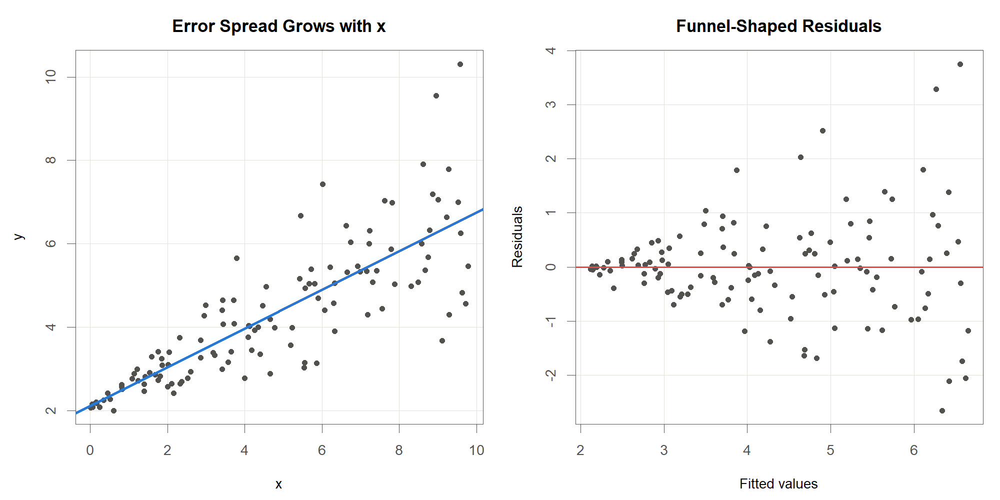
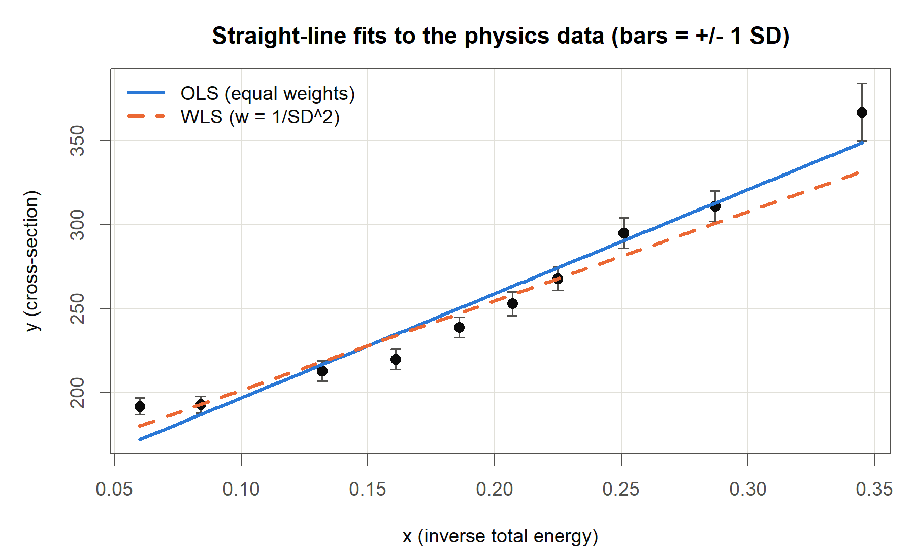
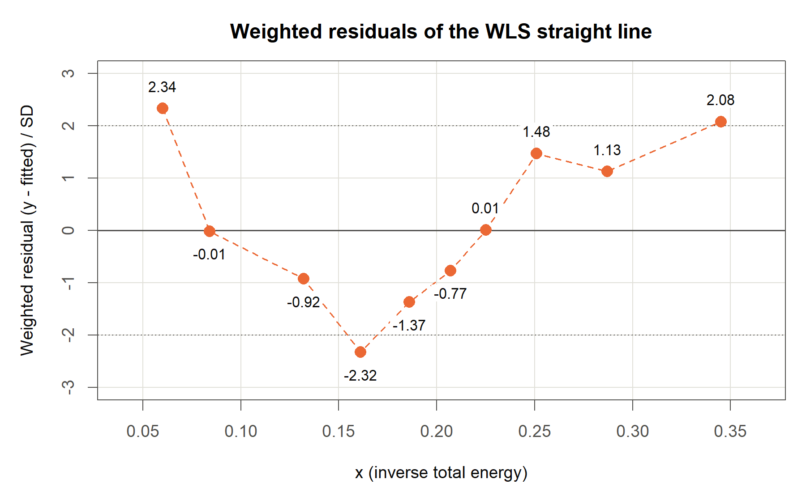
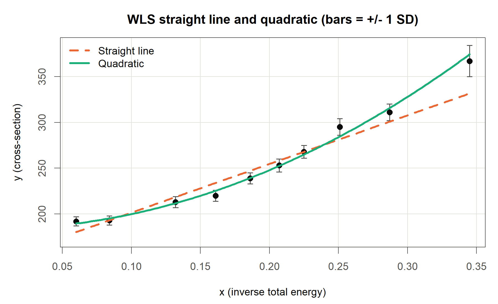
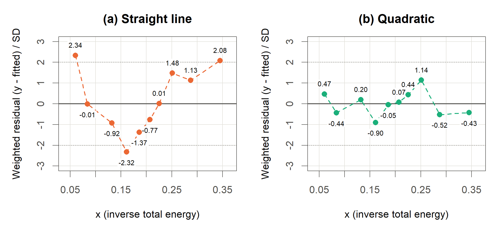
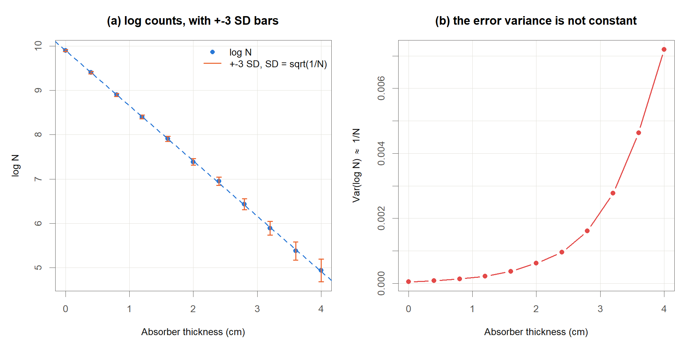
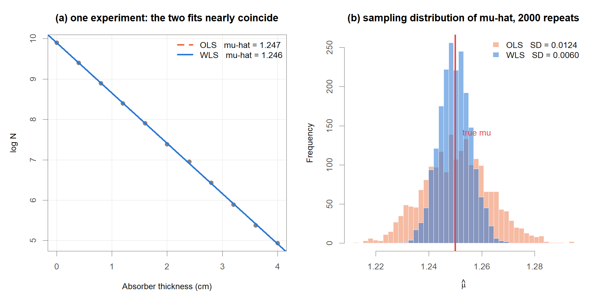
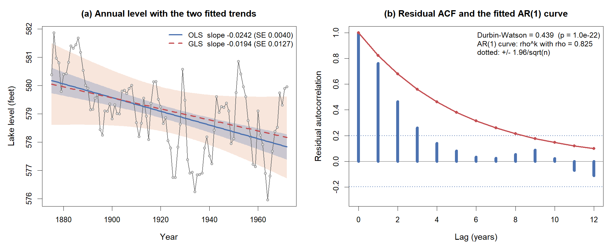

<!-- Date: 2026-08-26 | Purpose: chapter 6 of the KINS regression lecture, split from regression-lecture-note.qmd. Generated by code/agent/2026-08-26/split-chapters.py - edit the master, not this file. | File: 06-weighted-regression.qmd -->

# Weighted Regression

::: notes
특강 제목에도 들어 있는 가중회귀에 도착했습니다. 지금까지는 모든 관측값을 똑같이 믿는다는 전제로 직선을 맞춰 왔는데 이번 장은 다릅니다. 더 믿을 만한 측정에 더 큰 발언권을 주는 방법을 배우겠습니다.

여러분들 실험실 데이터와 가장 가까운 장이기도 합니다. 4장에서 최소제곱법이 왜 최선이라고 말할 수 있었는지, 그 근거가 무너지면 무엇으로 갈아타야 하는지를 차례로 보겠습니다.

이번 장에서 가장 시간을 많이 들일 부분은 검교정 곡선입니다. 이 특강을 요청하신 이유가 가중회귀로 검교정 곡선을 정하는 문제였기 때문에, 측정마다 표준편차가 기록된 실제 자료로 가중치를 정하는 것부터 곡선의 차수를 정하고 새 측정값에서 거꾸로 값을 읽어 내는 것까지 한 번에 따라가 보겠습니다. 오차끼리 상관이 있을 때 쓰는 GLS는 장 끝에서 짧게 다루겠습니다.
:::

## 이 장의 출발점

### <i class="fa-solid fa-question"></i> 질문

::: {.callout-note appearance="minimal"}
<i class="fa-solid fa-link"></i> **앞 장에서 여기까지**: 진단에서 잔차가 깔때기 모양으로 퍼지면 등분산 위반, 이웃한 잔차끼리 상관이 있으면 자기상관. <i class="fa-solid fa-circle-question"></i> **이 장의 질문**: 각 경우에 어떤 방법을 사용하는가. 측정마다 표준편차가 다른 검교정 곡선은 어떤 절차로 정하는가(자기상관은 이 장 끝의 일반화최소제곱, GLS)
:::

::: {.highlight-box}
모든 관측값을 동일한 신뢰도로 취급해야 하는가?
:::

### <i class="fa-solid fa-lightbulb"></i> 핵심

::: {.callout-tip appearance="minimal"}
<ul>
<li>계측기마다 교정 성적서에 적힌 <b>측정 불확도</b>가 다름</li>
<li>관측값이 서로 다른 횟수의 반복 측정을 평균한 값일 수 있음</li>
<li>관측별 신뢰도를 모형에 반영하는 장치가 필요함: 가중치 $w_i$</li>
<li>추정 대상인 조건부 기댓값 $E(y \mid x)$ 자체는 바뀌지 않음. 관측마다 주는 가중치만 달라짐</li>
</ul>
:::

**기호**

<ul>
<li>$w_i$: $i$번째 관측에 부여하는 가중치</li>
<li>그 관측이 추정에 미치는 영향의 크기를 조절</li>
</ul>

::: notes
같은 시료 하나를 세 가지 저울로 재는 상황을 생각해 보시기 바랍니다. 정밀 분석저울, 주방 저울, 그리고 낡은 체중계입니다. 세 숫자가 나왔을 때 이 셋을 그냥 산술평균하는 분은 없으실 것입니다. 정밀한 저울 쪽을 더 믿으시겠지요. 여러분들 실험실에서도 계측기마다 교정 성적서에 적힌 측정 불확도가 전부 다르지 않습니까. 이 상식을 수식으로 옮긴 것이 가중치, 곧 각 관측값에 주는 발언권입니다.

그러면 낡은 체중계 값은 버리면 되지 않느냐고 물으실 수 있습니다. 버리는 것은 발언권을 0으로 만드는 극단적인 선택입니다. 정보가 조금이라도 있다면 작은 발언권이라도 주는 쪽이 대개 손해가 적습니다.

하나만 더 짚겠습니다. 우리가 찾는 대상은 조건부 기댓값, 곧 $x$가 주어졌을 때 $y$의 평균이었습니다. 가중치를 준다고 그 과녁이 옮겨 가지는 않습니다. 즉, 과녁은 그대로 두고 회의실에서 누구 말을 더 크게 들을지만 다시 정하는 것입니다.
:::

## 등분산과 이분산: 정의

### <i class="fa-solid fa-bullseye"></i> 아래첨자 $i$ 의 유무

::: {.highlight-box}
**등분산(homoscedasticity)**: 모든 $i=1,\dots,n$에 대해 $\operatorname{Var}(\varepsilon_i)=\sigma^2$. 오차의 분산이 공통

**이분산(heteroscedasticity)**: $\operatorname{Var}(\varepsilon_i)=\sigma_i^2$. 오차의 분산이 관측마다 다름
:::

**기호**

<ul>
<li>$\varepsilon_i$: $i$번째 관측의 오차. 참 직선에서 그 관측이 위아래로 벗어난 양</li>
<li>$\operatorname{Var}$: 분산. 값들이 평균에서 흩어진 정도를 재는 수치</li>
<li>$\sigma^2$: 모든 관측에 공통인 오차 분산</li>
<li>$\sigma_i^2$: 관측마다 달라지는 오차 분산</li>
<li>$n$: 관측 수</li>
</ul>

::: {.callout-tip appearance="minimal"}
두 식의 차이는 아래첨자 $i$ 하나뿐이지만, 뒤에서 볼 결과의 차이는 작지 않음
:::

::: notes
지금까지 우리는 오차의 퍼짐이 어디에서나 같다는 약속을 깔고 왔는데 이것을 등분산이라고 부릅니다. 이 약속이 깨진 상황, 곧 오차의 퍼짐이 관측마다 달라지는 상황이 이분산입니다.

기호로 보면 차이가 작습니다. 시그마 제곱에 아래첨자 $i$가 붙었을 뿐인데 그 한 글자가 관측마다 퍼짐이 다르다는 뜻입니다.

분산이라는 말이 낯설면 이렇게 생각해 보시기 바랍니다. 과녁에 화살을 여러 발 쐈을 때 탄착군이 얼마나 넓게 퍼졌는가, 그 넓이가 분산입니다. 그러니 등분산은 어느 자리에서 쏘든 탄착군 크기가 같다는 뜻입니다.
:::

## 등분산과 이분산: 깔때기 신호

### <i class="fa-solid fa-chart-line"></i> 잔차 그림으로 확인

:::: {.columns}

::: {.column width="60%"}
{width=100%}
:::

::: {.column width="40%"}
::: {.callout-tip appearance="minimal"}
<i class="fa-solid fa-chart-line"></i> **이분산의 전형적 신호**

<ul>
<li>산점도: $x$가 커질수록 점들이 직선 주위로 넓게 퍼짐</li>
<li>잔차 그림: 왼쪽은 좁고 오른쪽은 넓은 <b>깔때기 모양</b></li>
<li>등분산이면 잔차가 위아래로 고른 띠를 이룸</li>
</ul>
:::
:::

::::

등분산은 자료가 저절로 만족해 주는 성질이 아니라 분석자가 걸어 둔 가정이므로, Diagnosis 장의 잔차 그림으로 확인해야 함

::: notes
왼쪽 그림을 보시면 $x$가 커질수록 점들이 직선 주위에서 점점 넓게 퍼지고, 오른쪽 잔차 그림에서는 같은 현상이 왼쪽은 좁고 오른쪽은 넓은 깔때기 모양으로 나타납니다. 이 깔때기가 이분산의 대표적인 신호입니다. 반대로 잔차가 위아래로 고르게 띠를 이루고 있다면 등분산 가정에 큰 문제는 없다고 보셔도 됩니다.

그러면 실무에서 이분산을 어떻게 알아챌까요? 검정 통계량보다 그림이 먼저입니다. 앞 장에서 배운 잔차 그림을 그려서 눈으로 확인하는 방법이 가장 빠릅니다. 눈에 깔때기가 보인다면 그다음에 무엇을 해야 하는지가 이 장의 나머지 내용입니다.
:::

## 등분산 위반: Gauss-Markov 복습

### <i class="fa-solid fa-lightbulb"></i> OLS가 최선이었던 근거

::: {.highlight-box}
**Gauss-Markov 정리**: 다음 두 조건이 성립하면 통상최소제곱 추정량 $\hat{\boldsymbol\beta}_{OLS}$는 BLUE

$$E(\boldsymbol\varepsilon \mid \mathbf X)=\mathbf 0, \qquad \operatorname{Var}(\boldsymbol\varepsilon \mid \mathbf X)=\sigma^2\mathbf I$$
:::

**기호**

<ul>
<li>$\boldsymbol\varepsilon$: 오차를 세로로 쌓은 $n\times 1$ 벡터</li>
<li>$\mathbf X$: 절편열을 포함한 $n\times(p+1)$ 설계행렬</li>
<li>$\mathbf I$: $n\times n$ 항등행렬</li>
<li>둘째 조건 = <b>등분산</b>(모든 오차의 분산이 $\sigma^2$ 로 같음) + <b>무상관</b>(서로 다른 관측의 오차가 함께 움직이지 않음)</li>
</ul>

::: {.callout-tip appearance="minimal"}
<i class="fa-solid fa-bullseye"></i> **BLUE(Best Linear Unbiased Estimator)**: $y$의 선형결합으로 만든 불편 추정량 가운데 분산이 가장 작은 것. **불편**은 같은 실험을 무수히 반복했을 때 추정값의 평균이 참값과 일치한다는 뜻
:::

::: notes
잠깐 4장으로 돌아가겠습니다. 최소제곱법이 최선이라고 말할 수 있었던 근거가 Gauss-Markov 정리였는데 조건은 두 줄입니다.

첫째, 오차의 평균이 0입니다. 모형이 체계적으로 위나 아래로 치우쳐 있지 않다는 뜻입니다. 둘째 줄이 오늘의 주인공인데 여기에 두 가지가 함께 들어 있습니다. 모든 오차의 퍼짐이 같다는 등분산, 그리고 서로 다른 관측의 오차가 함께 움직이지 않는다는 무상관입니다.

이 두 조건 아래에서 최소제곱 추정량은 BLUE, 곧 y의 선형결합으로 만든 편향 없는 추정량 가운데 가장 덜 흔들리는 추정량이 됩니다. 불편이라는 말은 어렵지 않습니다. 같은 실험을 수없이 반복하면 추정값들의 평균이 참값에 맞는다는 뜻입니다.
:::

## 등분산 위반: 무너지는 결론

### <i class="fa-solid fa-triangle-exclamation"></i> 불편이나 최소분산 아님

::: {.highlight-box}
이분산에서는 $\operatorname{Var}(\boldsymbol\varepsilon)=\sigma^2\mathbf I$가 성립하지 않으므로 Gauss-Markov 정리의 전제가 무너짐. $\hat{\boldsymbol\beta}_{OLS}$는 **여전히 불편추정량이지만 더 이상 최소분산이 아님**
:::

::: {.callout-tip appearance="minimal"}
<ul>
<li>편향은 생기지 않음: $E(\hat\beta_1)=\beta_1$이 그대로 성립함</li>
<li>최소분산이 아님: 분산이 더 작은 선형 불편 추정량이 존재함</li>
<li>표준오차가 왜곡됨: 등분산을 전제로 유도한 공식이기 때문</li>
<li>따라서 $t$-검정, $p$-값, 신뢰구간이 모두 틀어짐 (Kutner et al., 2005)</li>
</ul>
:::

**기호**

<ul>
<li>$\hat\beta_1$: 기울기의 추정량, $\beta_1$: 그 참값</li>
<li><b>표준오차</b>: 추정값이 표본마다 얼마나 흔들리는지를 재는 수치</li>
<li><b>$p$-값</b>: "기울기가 0이다"라는 가정이 옳다고 볼 때 지금 자료만큼 극단적인 결과가 나올 확률</li>
</ul>

::: notes
좋은 소식과 나쁜 소식이 있습니다. 좋은 소식은 기울기 추정에 편향이 없다는 것입니다. 평균적으로는 과녁 중심을 맞힙니다.

나쁜 소식은 둘입니다. 첫째, 화살의 흔들림이 필요 이상으로 큽니다. 분산이 더 작은 선형 불편 추정량이 어딘가에 있다는 뜻입니다. 둘째가 더 골치인데, 표준오차 공식 자체가 등분산을 전제로 만들어져 있어서 조준경 눈금이 틀어진 상태가 됩니다. 표준오차는 추정값이 표본을 바꿔 가며 얼마나 흔들리는지를 재는 숫자이고 p-값과 신뢰구간은 전부 이 숫자를 밟고 서 있으니, 밑돌이 틀어지면 그 위도 전부 틀어집니다.

그러면 OLS 결과를 다 버려야 할까요? 계수 값 자체는 참고하셔도 됩니다. 다만 검정과 구간은 믿지 마시고, 지금부터 배울 가중최소제곱으로 다시 적합하시는 편이 정석입니다.
:::

## 가중최소제곱(WLS): 목적함수 {.smaller}

### <i class="fa-solid fa-bullseye"></i> 정의

::: {.highlight-box}
가중최소제곱(weighted least squares)은 다음 **가중 잔차제곱합**을 최소화하는 값을 추정량으로 택함

$$\min_{\beta_0,\,\beta_1}\ \sum_{i=1}^{n} w_i\left(y_i-\beta_0-\beta_1 x_i\right)^2$$
:::

**기호**

<ul>
<li>$y_i$: 반응변수, $x_i$: 설명변수</li>
<li>$\beta_0,\beta_1$: 절편과 기울기</li>
<li>$w_i$: $i$번째 관측의 가중치, $n$: 관측 수</li>
</ul>

### <i class="fa-solid fa-lightbulb"></i> 핵심

::: {.callout-tip appearance="minimal"}
<ul>
<li>이론적 최적 가중치는 오차 분산의 역수: $w_i = 1/\sigma_i^2$</li>
<li>분산이 작은(정밀한) 관측일수록 큰 $w_i$를 받음</li>
<li>모든 $w_i=1$이면 통상최소제곱과 같음: <b>OLS는 WLS의 특수한 경우</b></li>
<li>가중치는 비율만 의미를 가짐. 전체에 같은 상수를 곱해도 추정값은 불변</li>
</ul>
:::

::: notes
아이디어는 하나입니다. 제곱오차를 더할 때 각 항 앞에 발언권을 곱하는 것입니다. 가중치가 큰 점은 오차의 벌점이 크게 매겨지니 직선이 그 점 가까이 지나가려고 애쓰게 되고, 반대로 가중치가 작은 점은 조금 멀리 지나가도 벌점이 작습니다.

이론적으로 가장 좋은 가중치는 그 관측이 가진 오차 분산의 역수입니다. 정밀한 저울일수록 발언권을 크게 주자는 상식이 그대로 수식이 된 셈입니다.

가중치의 절대 크기도 중요하냐는 질문이 자주 나오는데 아닙니다. 비율만 중요합니다. 모든 가중치에 10을 곱해도 직선은 그대로입니다.
:::

## 가중최소제곱(WLS): 행렬 해

### <i class="fa-solid fa-bullseye"></i> OLS 공식에 $\mathbf W$ 삽입

::: {.highlight-box}
$$\hat{\boldsymbol\beta}_W=(\mathbf X^\top \mathbf W \mathbf X)^{-1}\mathbf X^\top \mathbf W \mathbf y$$
:::

**기호**

<ul>
<li>$\mathbf y$: 반응변수를 세로로 쌓은 $n\times 1$ 벡터</li>
<li>$\mathbf X$: 절편열을 포함한 $n\times(p+1)$ 설계행렬</li>
<li>$\mathbf W=\operatorname{diag}(w_1,\dots,w_n)$: 가중치를 대각선에 놓고 나머지 자리를 0으로 채운 대각행렬</li>
<li>$\hat{\boldsymbol\beta}_W$: 가중최소제곱 추정량</li>
</ul>

::: {.callout-tip appearance="minimal"}
OLS 공식 $(\mathbf X^\top\mathbf X)^{-1}\mathbf X^\top\mathbf y$ 와 비교하면 $\mathbf X$ 와 $\mathbf y$ 사이에 $\mathbf W$ 가 끼어든 형태. $\mathbf W=\mathbf I$ 이면 OLS로 되돌아감
:::

::: notes
앞의 최소화 문제를 풀면 답이 한 줄로 나옵니다. OLS 공식과 나란히 놓고 보시면 $\mathbf X$와 $\mathbf y$ 사이사이에 가중치 행렬 $\mathbf W$가 끼어든 것뿐입니다. $\mathbf W$는 대각선에 발언권 $w_1$부터 $w_n$까지를 나란히 적고 나머지 칸은 전부 0으로 채운 행렬입니다.

그러면 모든 발언권이 1이면 어떻게 될까요? $\mathbf W$가 항등행렬이 되면서 공식이 정확히 OLS로 돌아갑니다. 그러니 새 공식을 외우실 필요는 없고 OLS에 발언권을 끼워 넣었다, 이렇게만 기억하시면 됩니다.

이 역행렬 계산을 직접 해야 하나 걱정하실 수 있는데 그렇지 않습니다. 계산은 프로그램이 하고 여러분들이 정하실 것은 $\mathbf W$ 의 대각선에 무엇을 넣을지, 그 하나뿐입니다.
:::

## 가중최소제곱(WLS): 해의 유도

### <i class="fa-solid fa-pen-to-square"></i> 절차는 OLS와 동일

::: {.callout-note appearance="minimal"}
가중 잔차제곱합을 행렬로 쓰면

$$S_W(\boldsymbol\beta)=\sum_{i=1}^{n} w_i\left(y_i-\mathbf x_i^\top\boldsymbol\beta\right)^2=(\mathbf y-\mathbf X\boldsymbol\beta)^\top\mathbf W(\mathbf y-\mathbf X\boldsymbol\beta)$$

$\boldsymbol\beta$로 미분해 $\mathbf 0$으로 놓으면 정규방정식을 얻음

$$\frac{\partial S_W}{\partial\boldsymbol\beta}=-2\,\mathbf X^\top\mathbf W(\mathbf y-\mathbf X\boldsymbol\beta)=\mathbf 0
\ \Longrightarrow\ \mathbf X^\top\mathbf W\mathbf X\,\hat{\boldsymbol\beta}_W=\mathbf X^\top\mathbf W\mathbf y$$

$\mathbf X^\top\mathbf W\mathbf X$ 가 가역이면 앞 슬라이드의 해
:::

**기호**

<ul>
<li>$\mathbf x_i^\top$: 설계행렬 $\mathbf X$ 의 $i$번째 행</li>
<li>$S_W(\boldsymbol\beta)$: 가중 잔차제곱합</li>
</ul>

::: notes
유도 절차는 4장에서 하셨던 것과 완전히 같습니다. 제곱합을 베타로 미분해서 0으로 놓으면 정규방정식이 나오고 역행렬을 곱하면 끝나는데, 달라진 것은 식 가운데에 $\mathbf W$가 하나 들어간 것뿐입니다.

미분 과정이 눈에 들어오지 않으셔도 괜찮습니다. 결론만 가져가시면 됩니다. 가중치를 넣어도 푸는 방식은 그대로이고 답의 모양도 그대로, 이 두 가지입니다.
:::

## 가중치를 정하는 규칙 {.smaller}

### <i class="fa-solid fa-table"></i> 실무 규칙

| Situation | Weight $w_i$ |
|:---|:---|
| 측정 분산 $\sigma_i^2$ 또는 표준편차 $\sigma_i$ 를 아는 경우(교정 성적서, 반복 측정) | $w_i = 1/\sigma_i^2$ |
| $y_i$가 $n_i$개 측정값의 평균인 경우 | $w_i = n_i$ |
| 퍼짐이 $x_i$에 비례해 커지는 경우 | $w_i \propto 1/x_i$ |

: Practical rules for choosing weights (Kutner et al., 2005)

**기호**

<ul>
<li>$\sigma_i^2$: $i$번째 관측의 오차 분산, $\sigma_i$: 그 표준편차. 기록된 값이 표준편차이면 제곱한 뒤 역수</li>
<li>$n_i$: $y_i$ 를 만들 때 평균한 측정 횟수</li>
<li>$\propto$: "비례한다"는 기호</li>
</ul>

### <i class="fa-solid fa-lightbulb"></i> 핵심

::: {.highlight-box}
세 규칙은 모두 하나의 원리에서 나옴: **가중치는 분산의 역수**. $n_i$개 측정값을 평균하면 그 평균의 분산이 $\sigma^2/n_i$이므로, 역수를 취하면 $w_i \propto n_i$가 됨
:::

::: notes
그러면 실무에서 가중치를 어떻게 정할까요? 규칙은 하나입니다. 그 관측값의 분산을 알아내서 역수를 취하는 것, 이것이 전부입니다.

첫째 줄, 교정 성적서나 반복 측정으로 분산을 이미 알고 있다면 그대로 역수를 쓰시면 됩니다. 다만 성적서나 측정 기록에 적힌 값이 분산이 아니라 표준편차라면 그 값을 먼저 제곱해서 분산으로 바꾼 다음 역수를 취하셔야 하는데, 뒤의 물리 측정 예제가 바로 이 경우입니다. 둘째 줄, $y_i$가 여러 번 측정한 값의 평균이라면 평균의 분산은 측정 횟수만큼 나눠져 작아지니 가중치는 측정 횟수에 비례하게 줍니다. 다섯 번 잰 평균이 한 번 잰 값보다 다섯 배 믿을 만하다는 뜻입니다. 셋째 줄, 앞의 깔때기 그림처럼 퍼짐이 $x$에 비례해 커진다면 가중치는 $x$의 역수에 비례하게 잡습니다.

그러면 분산 정보가 아예 없으면 어떻게 할까요? 그때는 잔차 그림으로 분산이 어느 변수를 따라 커지는지 구조를 먼저 추정하고 그것으로 가중치를 만들어 다시 적합합니다. 요점은 하나입니다. 즉, 가중치에는 근거가 있어야 합니다.
:::

## 가중치의 실무 적용: 감마선 검교정

### <i class="fa-solid fa-screwdriver-wrench"></i> 분산을 이미 아는 경우

::: {.callout-tip appearance="minimal"}
Introduction 장에서 소개한 사례가 앞 표의 첫째 줄에 해당함

<ul>
<li>검출기의 검출 효율 곡선을 적합하는 검교정 문제</li>
<li>각 측정점의 분산이 <b>계수 통계(counting statistics)</b>로 이미 알려져 있음</li>
<li>따라서 가중치를 추정하지 않고 곧바로 계산함: $w_i = 1/\sigma_i^2$</li>
<li>오차 분산을 알고 오차가 서로 무상관이면, 역분산 가중이 선형 불편 추정량 가운데 최소분산을 줌</li>
<li>뒤의 물리 측정 예제가 같은 구조: 측정마다 기록된 표준편차로 가중치를 정하고 검교정 곡선을 적합함</li>
</ul>
:::

**기호**

<ul>
<li>$\sigma_i$: $i$번째 측정점 계수율의 표준편차</li>
<li>계수 통계에서 곧바로 계산되는 값</li>
</ul>

::: {.aside}
*Analytical Chemistry* 91(7) (2019), doi:10.1021/acs.analchem.9b00119. / INMM Annual Meeting Proceedings, "Weighted Least Squares Fitting of Gamma Spectroscopy Efficiency Functions".
:::

::: notes
첫 장에서 잠깐 보여 드린 감마선 분광 효율 검교정으로 돌아가겠습니다. 이 문제가 가중회귀의 교과서적인 사례인데, 각 측정점의 분산을 따로 추정할 필요가 없기 때문입니다.

계수 통계에서 이미 나와 있습니다. 방사선 계수는 세는 횟수 자체가 확률적으로 흔들리는데 그 흔들림의 크기가 이론적으로 알려져 있어서, 곧장 분산의 역수를 가중치로 넣습니다. 추정 단계가 하나 통째로 빠지니 깔끔합니다.

그리고 이렇게 분산을 아는 상황에서는 역분산 가중이 최선이라는 사실이 이론으로 보장됩니다. 여러분들 현장의 계측 자료 중에 이런 성격을 가진 것이 꽤 많을 것입니다.

다음 슬라이드부터는 같은 구조를 가진 실제 자료로, 측정마다 적힌 표준편차에서 가중치를 정하는 것부터 검교정 곡선의 모양을 정하고 새 측정값에서 거꾸로 값을 읽어 내는 것까지 차례로 따라가 보겠습니다.
:::

## 물리 측정 예제: 표준편차가 기록된 자료 {.smaller}

### <i class="fa-solid fa-table"></i> 열 개 측정값 전체

| $i$ | 1 | 2 | 3 | 4 | 5 | 6 | 7 | 8 | 9 | 10 |
|:--|--:|--:|--:|--:|--:|--:|--:|--:|--:|--:|
| $x_i$ | 0.345 | 0.287 | 0.251 | 0.225 | 0.207 | 0.186 | 0.161 | 0.132 | 0.084 | 0.060 |
| $y_i$ | 367 | 311 | 295 | 268 | 253 | 239 | 220 | 213 | 193 | 192 |
| $\mathrm{SD}_i$ | 17 | 9 | 9 | 7 | 7 | 6 | 6 | 6 | 5 | 5 |
| $w_i=1/\mathrm{SD}_i^2$ | 0.00346 | 0.0123 | 0.0123 | 0.0204 | 0.0204 | 0.0278 | 0.0278 | 0.0278 | 0.0400 | 0.0400 |

: Physics data, all n = 10 measurements (Weisberg, 2014; original data from Weisberg et al., 1978)

::: {.callout-tip appearance="minimal"}
<ul>
<li>$\pi^+$ 중간자 산란 실험의 측정 자료, $n=10$</li>
<li>$x$: 총에너지의 역수(설명변수), $y$: 산란 단면적(반응변수)</li>
<li>$\mathrm{SD}_i$: $y_i$ 의 <b>표준편차</b>. 분산은 그 제곱 $\mathrm{SD}_i^2$</li>
<li>가중치는 분산의 역수 $w_i=1/\mathrm{SD}_i^2$. 1번 점($\mathrm{SD}=17$)의 가중치는 9·10번 점($\mathrm{SD}=5$)의 $25/289=0.0865$ 배</li>
</ul>
:::

::: notes
이제 실제 자료로 검교정 곡선을 정해 보겠습니다. 이 자료는 Weisberg의 회귀분석 교재에 실린 물리 실험 자료이고, 원래는 1978년 Physical Review D에 실린 산란 실험의 측정값입니다. 관측이 열 개뿐인 작은 자료라서 이번에는 열 개를 모두 표에 올려 두었습니다. 셋째 줄의 SD가 각 측정값의 표준편차인데, 여러분들이 교정 성적서나 측정 기록에서 보시는 불확도가 이 자리에 들어간다고 생각하시면 됩니다.

여기서 한 가지를 분명히 해 두겠습니다. 이 자료에 적혀 있는 것은 분산이 아니라 표준편차이고, 앞의 규칙에서 가중치는 분산의 역수라고 했으니 적힌 값을 먼저 제곱해서 분산으로 바꾼 다음 역수를 취해야 합니다. 그래서 가중치가 1/SD가 아니라 1/SD²입니다. 표준편차를 그대로 역수로 쓰면 정밀한 점과 덜 정밀한 점의 차이가 실제보다 작게 반영되는데, 이 자료에서 1번 점의 표준편차는 9번·10번 점의 3.4배이지만 가중치로는 0.0865배, 곧 약 12분의 1이 됩니다.
:::

## 1차식 적합: OLS와 WLS의 두 직선

### <i class="fa-solid fa-chart-line"></i> 오차막대 $\pm\mathrm{SD}_i$ 와 함께 보기

:::: {.columns}

::: {.column width="60%"}
{width=100%}
:::

::: {.column width="40%"}
::: {.callout-tip appearance="minimal"}
<i class="fa-solid fa-lightbulb"></i> **읽는 법**

<ul>
<li>세로 막대: 각 측정의 $y_i\pm\mathrm{SD}_i$</li>
<li>실선: 모든 점에 같은 가중치를 준 OLS</li>
<li>점선: $w_i=1/\mathrm{SD}_i^2$ 를 준 WLS</li>
<li>오른쪽 끝 점($\mathrm{SD}=17$)의 가중치가 가장 작아, WLS 직선은 그 점에서 멀어지고 왼쪽의 정밀한 점들에 가까워짐</li>
</ul>
:::
:::

::::

::: notes
그림에서 세로 막대는 각 측정값에 표준편차 하나만큼을 위아래로 그린 것입니다. 오른쪽 끝 점의 막대가 가장 길고 왼쪽으로 갈수록 짧아지는데, 막대가 짧을수록 정밀한 측정이고 그만큼 큰 발언권을 받습니다. 파란 실선이 모든 점을 똑같이 대접한 OLS이고 주황 점선이 1/SD²을 가중치로 준 WLS입니다.

두 직선이 갈라지는 자리는 오른쪽 끝입니다. OLS는 막대가 가장 긴 오른쪽 끝 점에도 다른 점과 같은 발언권을 주기 때문에 그쪽으로 끌려 올라가고, WLS는 그 점의 발언권을 가장 정밀한 점의 약 12분의 1로 줄이는 대신 왼쪽의 막대가 짧은 점들에 맞춥니다.

그런데 그림을 조금 더 보시면 눈에 걸리는 것이 하나 있습니다. 가운데에 있는 점들은 두 직선보다 아래쪽에 몰려 있고, 양 끝 점은 직선보다 위에 있습니다. 직선 하나로는 이 자료를 다 설명하지 못하고 있다는 신호일 수 있는데, 이것이 정말 의미 있는 어긋남인지는 몇 장 뒤에서 잔차로 확인하겠습니다.
:::

## 1차식 적합: 추정 결과 {.smaller}

### <i class="fa-solid fa-table"></i> 계수와 표준오차의 변화

**추정 경로**

자료에 기록된 $\mathrm{SD}_i$ 는 각 $y_i$ 의 **표준편차**. 가중치는 분산의 역수이므로

$$
\mathbf W=\operatorname{diag}\!\Big(\frac{1}{\mathrm{SD}_1^2},\dots,\frac{1}{\mathrm{SD}_{10}^2}\Big),
\qquad
\hat{\boldsymbol\beta}_{\mathrm{WLS}}=(\mathbf X^\top\mathbf W\mathbf X)^{-1}\mathbf X^\top\mathbf W\mathbf y
$$

$$
\operatorname{Var}(\hat{\boldsymbol\beta}_{\mathrm{WLS}})=\sigma^2(\mathbf X^\top\mathbf W\mathbf X)^{-1},
\qquad
\hat\sigma^2=\frac{S_W(\hat{\boldsymbol\beta}_{\mathrm{WLS}})}{n-2}
$$

$\mathbf W=\mathbf I$ 로 두면 두 식이 그대로 OLS의 $(\mathbf X^\top\mathbf X)^{-1}\mathbf X^\top\mathbf y$ 와 $\sigma^2(\mathbf X^\top\mathbf X)^{-1}$ 이 됨. $S_W$ 는 앞의 가중 잔차제곱합

**추정 결과**

| Estimate | OLS | WLS |
|:---|:---|:---|
| $\hat\beta_0$ (intercept) | 135.0 (SE 10.1) | 148.5 (SE 8.08) |
| $\hat\beta_1$ (slope) | 619.7 (SE 47.7) | 530.8 (SE 47.6) |

: OLS vs WLS straight-line estimates on the physics data (n = 10). SE uses the estimated $\hat\sigma^2$; weighted $R^2$ of the WLS fit = 0.940

**결과 읽기**

::: {.callout-tip appearance="minimal"}
<ul>
<li>기울기 추정: 619.7에서 530.8로 이동함</li>
<li>표준오차: 절편은 10.1에서 8.08로 감소, 기울기는 47.7과 47.6으로 거의 같음</li>
<li>WLS의 $\hat\sigma^2=2.74$. 이 값의 뜻은 뒤의 적합결여 검정에서 다룸</li>
<li>표준오차의 크기 비교보다, 측정마다 다른 분산을 반영한 표준오차를 쓰게 되었다는 점이 중요함</li>
</ul>
:::

::: notes
추정 경로에서 OLS와 달라진 곳은 한 군데뿐입니다. $\mathbf X$ 와 $\mathbf y$ 사이사이에 $\mathbf W$ 가 끼어든 것이고, $\mathbf W$ 의 대각선에는 표준편차를 제곱해서 역수를 취한 값이 들어갑니다. 아래 줄은 분산 공식인데 4장에서 본 시그마 제곱 곱하기 역행렬과 모양이 같고, 시그마 제곱을 추정할 때 잔차제곱합 대신 가중치를 곱한 잔차제곱합을 쓴다는 점만 다릅니다.

표를 보시면 기울기가 619.7에서 530.8로 움직였습니다. 앞 그림에서 OLS가 오른쪽 끝 점 쪽으로 끌려 올라가 있던 것이 숫자로는 이 차이입니다. 표준오차는 절편이 10.1에서 8.08로 줄었고 기울기는 47.7과 47.6으로 거의 같습니다.

그러면 표준오차가 별로 줄지도 않았는데 가중치를 넣을 이유가 있느냐고 물으실 수 있습니다. OLS의 표준오차는 모든 점의 분산이 같다는 전제로 계산한 값이라서, 이 자료처럼 표준편차가 5부터 17까지 다른 자료에서는 그 숫자를 믿을 근거가 없습니다. 반면 WLS의 표준오차는 측정마다 다른 분산을 반영한 값입니다. 즉, 두 숫자가 비슷하게 나온 것은 이 자료에서 그렇게 된 것일 뿐이고, 중요한 것은 어느 쪽이 맞는 계산이냐입니다.

마지막으로 시그마 제곱의 추정값 2.74를 기억해 두시면 좋겠습니다. 표준편차를 정확히 알고 있고 직선이 맞는 모형이라면 이 값은 1 근처에 나와야 하는데, 2.74가 나왔다는 것이 무슨 뜻인지는 적합결여 검정에서 다시 보겠습니다.
:::

## 가중 잔차: 측정의 SD로 나눈 잔차 {.smaller}

### <i class="fa-solid fa-bullseye"></i> 정의

::: {.highlight-box}
**가중 잔차(weighted residual)**: 잔차에 가중치의 제곱근을 곱한 값. $w_i=1/\mathrm{SD}_i^2$ 이면 잔차를 그 측정의 표준편차로 나눈 값

$$r_i^{w}=\sqrt{w_i}\,e_i=\frac{y_i-\hat y_i}{\mathrm{SD}_i}$$
:::

<ul>
<li>$e_i=y_i-\hat y_i$: WLS 적합의 잔차(5장의 정의와 같음), $r_i^{w}$: 가중 잔차. 단위가 없고 "표준편차 몇 개만큼 벗어났는가"를 나타냄</li>
</ul>

::: {.callout-tip appearance="minimal"}
<i class="fa-solid fa-lightbulb"></i> **나누는 이유**

<ul>
<li>측정마다 분산이 다르므로 $e_i$ 를 그대로 비교할 수 없음. 1차식 WLS에서 $e_1=35.4$ ($\mathrm{SD}_1=17$), $e_{10}=11.7$ ($\mathrm{SD}_{10}=5$) 이지만 가중 잔차는 $2.08$, $2.34$ 로 비슷함</li>
<li>가중 잔차의 제곱합이 곧 WLS의 목적함수 값: $\sum_i (r_i^{w})^2=S_W(\hat{\boldsymbol\beta}_W)$</li>
</ul>
:::

::: {.callout-note appearance="minimal"}
<i class="fa-solid fa-link"></i> **5장의 스튜던트화 잔차 $r_i=e_i/(\hat\sigma\sqrt{1-h_{ii}})$ 와의 관계**

<ul>
<li>$r_i^{w}$ 는 $\hat\sigma$ 대신 $\mathrm{SD}_i$ 로 나누고, 레버리지 보정 $\sqrt{1-h_{ii}}$ 로는 <b>나누지 않은</b> 값</li>
<li>$\mathrm{SD}_i$ 를 정확히 알면 $\operatorname{Var}(r_i^{w})=1-h_{ii}<1$. 여기서 $h_{ii}$ 는 가중 모자행렬 $\mathbf H_W=\mathbf W^{1/2}\mathbf X(\mathbf X^\top\mathbf W\mathbf X)^{-1}\mathbf X^\top\mathbf W^{1/2}$ 의 대각원소</li>
<li>따라서 레버리지가 큰 끝 점일수록 작게 나옴. 1차식의 10번 점: $h_{ii}=0.462$, $r_i^{w}=2.34$, $\sqrt{1-h_{ii}}$ 로 나누면 $3.18$</li>
</ul>
:::

::: notes
잔차 그림을 그리기 전에 무엇을 그릴지부터 정하겠습니다. 5장에서는 잔차를 그대로 그리지 않고 크기를 맞춘 스튜던트화 잔차를 그렸는데, 이 자료에서는 크기를 맞춰야 할 이유가 하나 더 있습니다. 측정마다 표준편차가 5부터 17까지 다르기 때문입니다.

예를 하나 보겠습니다. 직선에서 1번 점은 35.4만큼 벗어났고 10번 점은 11.7만큼 벗어났습니다. 숫자만 보면 1번 점이 세 배나 더 튀는 것 같지만, 1번 점은 원래 표준편차가 17인 덜 정밀한 측정이고 10번 점은 5인 정밀한 측정입니다. 각자의 표준편차로 나누면 2.08과 2.34가 되어, 둘 다 표준편차 두 개 남짓 벗어난 비슷한 정도라는 것을 알 수 있습니다. 이렇게 표준편차로 나눈 값이 가중 잔차이고, 가중 잔차를 제곱해서 모두 더하면 WLS가 최소화했던 가중 잔차제곱합이 그대로 나옵니다.

5장의 스튜던트화 잔차와 같은 것이냐는 질문이 나올 수 있습니다. 비슷하지만 같지는 않습니다. 5장에서는 루트 1 빼기 h, 곧 레버리지 보정까지 나눴는데 가중 잔차에는 그 보정이 들어 있지 않습니다. 그래서 레버리지가 큰 양 끝 점에서는 가중 잔차가 실제보다 작게 나옵니다. 10번 점은 레버리지가 0.462로 커서 보정하면 2.34가 3.18이 됩니다. 즉, 가중 잔차 그림에서 끝 점이 2 근처에 있다면 실제로는 그보다 더 벗어나 있을 수 있다고 읽으셔야 합니다.
:::

## 1차식의 가중 잔차: 양 끝은 양수, 가운데는 음수 {.fig-led}

### <i class="fa-solid fa-chart-line"></i> 가중 잔차 대 $x$

{width=100% .nostretch}

::: {.callout-tip appearance="minimal"}
<ul>
<li>$x$ 가 작은 쪽부터: 끝 점 $2.34$, 가운데 다섯 점 $-0.01\sim-2.32$, $x\ge0.225$ 의 네 점 $0.01,\ 1.48,\ 1.13,\ 2.08$</li>
<li>5장 <b>잔차그림과 가정 위반</b>의 (d) 곡선 패턴. 퍼짐이 아니라 <b>평균 구조(직선)의 설정 오류</b> 신호</li>
<li>기울기가 양수인 직선에서는 $\hat y_i$ 의 순서가 $x_i$ 의 순서와 같으므로, 적합값 대비 그림과 같은 모양</li>
</ul>
:::

::: notes
가중 잔차를 x에 대해 그린 그림입니다. 위아래 점선은 플러스마이너스 2인데, 표준편차 두 개만큼의 범위라고 보시면 됩니다.

왼쪽부터 따라가 보겠습니다. 맨 왼쪽 점이 2.34로 위에 있고, 그다음 다섯 점은 0이거나 0보다 아래로 내려가서 가장 낮은 점이 마이너스 2.32입니다. 그리고 x가 0.225를 넘으면 다시 올라가서 1.48, 1.13, 2.08이 됩니다. 양 끝은 위에 있고 가운데는 아래에 있는 U자 모양인데, 5장에서 잔차그림의 여섯 가지 유형을 보면서 (d)라고 불렀던 바로 그 모양입니다.

이 모양은 퍼짐의 문제가 아니라 모양의 문제입니다. 자료의 실제 관계는 아래로 볼록하게 휘어 있는데 우리가 직선을 그었기 때문에, 가운데에서는 직선이 점들보다 위를 지나가고 양 끝에서는 아래를 지나가는 것입니다. 앞의 그림을 보면서 가운데 점들이 직선 아래에 몰려 있다고 말씀드린 것이 이것입니다.

5장 그림은 가로축이 적합값이었는데 여기서는 x를 썼습니다. 직선의 기울기가 양수이면 적합값이 x와 같은 순서로 늘어서기 때문에 어느 쪽으로 그려도 모양이 같습니다. 그러면 점 열 개로 이런 무늬를 판단해도 되느냐는 의문이 드실 수 있는데, 눈으로 본 것만으로는 부족하니 다음 슬라이드에서 숫자로 확인하겠습니다.
:::

## 적합결여 검정: 잔차의 크기와 SD의 비교 {.smaller}

### <i class="fa-solid fa-bullseye"></i> SD를 알 때의 카이제곱 검정

::: {.highlight-box}
**적합결여 검정(lack-of-fit test)**: $\mathrm{SD}_i$ 가 정확히 알려져 있고, 평균 구조가 옳고, 오차가 서로 독립인 정규분포이면

$$X^2=\sum_{i=1}^{n}\Big(\frac{y_i-\hat y_i}{\mathrm{SD}_i}\Big)^2=\sum_{i=1}^{n}(r_i^{w})^2\ \sim\ \chi^2(n-p-1)$$
:::

<ul>
<li>$X^2$: 적합결여 통계량. 2장 <b>카이제곱분포</b>의 $SSE/\sigma^2\sim\chi^2(n-p-1)$ 에서 $SSE$ 를 $S_W$ 로, $\sigma^2$ 를 1로 바꾼 것</li>
<li>$p$: 설명항의 개수(1차식 1, 2차식 2), $n-p-1$: 잔차의 자유도</li>
<li>$X^2$ 가 $\chi^2(n-p-1)$ 의 위쪽 꼬리에 있으면 세 전제 가운데 적어도 하나를 의심. 잔차 그림에 곡선이 있으면 평균 구조를, 없으면 $\mathrm{SD}_i$ 의 과소 기록을 먼저 의심</li>
</ul>

| Model | $X^2$ | df | $X^2/\text{df}$ | $p$ |
|:--|--:|--:|--:|--:|
| Straight line | 21.95 | 8 | 2.74 | 0.00500 |
| Quadratic (next slide) | 3.23 | 7 | 0.461 | 0.863 |

: Lack-of-fit chi-square tests with known SD (physics data, n = 10)

::: {.callout-note appearance="minimal"}
<i class="fa-solid fa-scale-balanced"></i> **$\sigma^2$ 와의 관계**: 모형을 $\operatorname{Var}(\varepsilon_i)=\sigma^2\mathrm{SD}_i^2$ 로 쓰면

<ul>
<li>$\mathrm{SD}_i$ 의 <b>비</b>만 알 때: $\sigma^2$ 를 $\hat\sigma^2=S_W(\hat{\boldsymbol\beta}_W)/(n-p-1)$ 로 추정. 이 장 계수표의 표준오차가 이 방식</li>
<li>$\mathrm{SD}_i$ 의 <b>절대 크기</b>를 알 때: $\sigma^2=1$. 이때 $\hat\sigma^2=X^2/(n-p-1)$ 이므로 <b>$\hat\sigma^2\approx1$ 인지 보는 것이 곧 적합결여의 점검</b></li>
</ul>
:::

::: notes
그림에서 본 U자 모양이 우연인지 숫자로 확인하는 방법입니다. 이 자료처럼 측정마다 표준편차를 알고 있으면 아주 간단한 검정이 하나 생기는데, 가중 잔차를 제곱해서 모두 더한 값 X제곱을 보는 것입니다.

생각은 이렇습니다. 모형이 맞고 표준편차도 정확하다면 가중 잔차는 하나하나가 대략 표준편차 하나 정도씩만 벗어나야 하니, 제곱해서 더하면 대략 자유도만큼의 값이 나와야 합니다. 정확히는 세 전제가 모두 맞을 때 X제곱이 자유도 n−p−1인 카이제곱분포를 따릅니다. 직선은 자유도가 8이니 8 근처가 나와야 하는데 21.95가 나왔고 p값이 0.005입니다. 자유도 8인 카이제곱분포의 95퍼센트 지점이 15.5이니 그보다도 훨씬 큽니다. 즉, 직선과 주어진 표준편차로는 이 자료의 흩어짐을 설명할 수 없다는 뜻입니다.

그러면 무엇이 틀렸을까요? 이 검정만으로는 모형이 틀렸는지 표준편차가 너무 작게 적혀 있는지 구별하지 못하기 때문에 앞의 잔차 그림이 필요합니다. 잔차에 U자 무늬가 뚜렷했으니 이 경우는 직선이라는 모양을 먼저 의심하는 것이 순서입니다. 표의 둘째 줄 2차식은 다음 슬라이드에서 적합할 곡선인데, 미리 결과를 말씀드리면 X제곱이 3.23으로 떨어지고 p값이 0.863이 됩니다.

아래 상자는 앞에서 계수의 표준오차를 구할 때 쓴 시그마 제곱과의 관계입니다. 가중치의 비율만 안다면 시그마 제곱을 자료에서 추정해야 하고, 이 장의 계수표에 있는 표준오차는 그렇게 계산한 값입니다. 그런데 표준편차의 절대 크기까지 안다면 시그마 제곱은 1이어야 하고, 시그마 제곱의 추정값을 구하는 식이 X제곱을 자유도로 나눈 것과 똑같기 때문에 추정값이 1에서 많이 벗어나는지를 보는 것이 곧 적합결여 점검이 됩니다. 직선의 2.74는 1보다 크게 벗어났고, 2차식의 0.461은 1보다 작지만 자유도가 7밖에 안 되는 상황에서 이 정도 차이는 우연으로 충분히 나올 수 있는 크기입니다.

한 가지 주의하실 점이 있습니다. 교정 성적서에 확장불확도가 적혀 있다면 그 값은 표준불확도에 포함인자를 곱한 것이라서, 포함인자로 나눠 표준불확도로 바꾼 뒤에 쓰셔야 합니다. 그대로 쓰면 X제곱이 포함인자의 제곱만큼 작아져서 맞지 않는 모형도 이 검정을 통과하게 됩니다.
:::

## 2차식 적합: 계수에 대해서는 선형 {.smaller}

### <i class="fa-solid fa-bullseye"></i> 모형

::: {.highlight-box}
$$y_i=\beta_0+\beta_1x_i+\beta_2x_i^2+\varepsilon_i,\qquad \operatorname{Var}(\varepsilon_i)=\sigma^2\mathrm{SD}_i^2$$

$x$ 에 대해서는 곡선이지만 계수 $\beta_0,\beta_1,\beta_2$ 에 대해서는 선형. 설계행렬에 $x_i^2$ 열을 더한 4장의 다중회귀이므로 WLS 해 $(\mathbf X^\top\mathbf W\mathbf X)^{-1}\mathbf X^\top\mathbf W\mathbf y$ 를 그대로 사용
:::

:::: {.columns}

::: {.column width="56%"}
{width=100%}
:::

::: {.column width="44%"}
| Estimate | Straight line | Quadratic |
|:--|--:|--:|
| $\hat\beta_0$ | 148.5 (8.08) | 183.8 (6.46) |
| $\hat\beta_1$ | 530.8 (47.6) | 0.971 (85.4) |
| $\hat\beta_2$ | | 1597.5 (251) |
| $R^2_w$ | 0.940 | 0.991 |

: WLS estimates (SE) with $w_i = 1/\mathrm{SD}_i^2$; SE uses the estimated $\hat\sigma^2$
:::

::::

<ul>
<li>$\mathbf X$: 열이 $1,\ x_i,\ x_i^2$ 인 $10\times3$ 설계행렬</li>
<li>$R^2_w=1-S_W(\hat{\boldsymbol\beta}_W)\big/\sum_i w_i(y_i-\bar y_w)^2$: 가중 결정계수, $\bar y_w=\sum_i w_iy_i\big/\sum_i w_i$: 가중평균</li>
</ul>

::: notes
잔차가 U자를 그렸으니 처방은 5장의 처방 표에 적어 두었던 대로 곡선 항을 넣는 것이고, 가장 간단한 곡선은 x의 제곱 항을 하나 더한 2차식입니다.

여기서 2차식이면 비선형 회귀가 아니냐고 물으시는 분들이 많습니다. 그렇지 않습니다. 그래프로 그리면 곡선이지만, 우리가 추정하는 베타0, 베타1, 베타2는 식에 1차로만 들어가 있습니다. x 제곱을 새 설명변수 하나로 보고 설계행렬에 열을 하나 더 붙이면 4장의 다중회귀와 똑같은 모양이 되고, 가중치도 똑같이 1/SD²을 넣어서 앞에서 본 WLS 공식으로 그대로 풉니다. 즉, 회귀에서 선형이라는 말은 x에 대해서가 아니라 계수에 대해서 선형이라는 뜻입니다.

그림을 보시면 녹색 곡선이 열 개 가운데 아홉 개 점의 오차막대 안을 지나가고, 점선 직선이 놓치던 가운데 점들과 오른쪽 끝 점을 함께 따라갑니다. 가중 결정계수도 0.940에서 0.991로 올랐습니다. 다만 결정계수는 항을 넣으면 줄어들지 않는 값이라서 오른 것만으로는 2차식이 낫다는 근거가 되지 않고, 근거는 다음 슬라이드에서 검정과 잔차로 확인하겠습니다.

표에서 이상하게 보이는 숫자가 하나 있을 것입니다. 2차식의 베타1이 0.971인데 표준오차가 85.4라서 0과 구별이 안 됩니다. 그렇다고 1차항을 빼라는 뜻은 아닙니다. 이 자료에서는 x와 x²이 거의 함께 움직여서, 가중치를 반영해 계산한 VIF가 19.2로 5장의 기준 10을 넘습니다. 게다가 베타1은 x가 0일 때 곡선의 기울기인데 x=0은 자료 범위인 0.060에서 0.345 밖에 있습니다. x를 가중평균으로 중심화해서 다시 적합하면 VIF는 1.10으로 떨어지고 1차항 계수는 492, 표준오차는 20.4가 됩니다. 곡선 자체와 적합값은 그대로이고 계수를 나타내는 방식만 바뀐 것입니다.

마지막으로 표의 표준오차는 앞의 직선과 같은 방식, 곧 시그마 제곱을 추정해서 구한 값입니다. 표준편차의 절대 크기를 그대로 믿고 시그마 제곱을 1로 두면 표준오차는 이 값의 약 1.47배가 됩니다.
:::

## 1차식과 2차식 비교: 2차항의 F 검정과 재진단 {.smaller}

### <i class="fa-solid fa-scale-balanced"></i> 추가제곱합 $F$ 와 가중 잔차

::: {.highlight-box}
4장 **회귀계수 일부에 대한 검정**의 $SSE$ 를 가중 잔차제곱합 $S_W$ 로 바꾼 것. 축소모형(RM) = 1차식, 완전모형(FM) = 2차식, $H_0:\beta_2=0$, $k=1$

$$F=\frac{\{S_W(\text{RM})-S_W(\text{FM})\}/1}{S_W(\text{FM})/7}=\frac{(21.95-3.23)/1}{3.23/7}=40.6,\qquad p=0.000376$$
:::

{height=350}

<ul>
<li>$F(1,\,7)$ 기준 $p=0.000376$: 2차항이 필요함</li>
<li>(a)의 U자 무늬가 (b)에서 사라지고, 모든 가중 잔차가 $|r_i^{w}|\le1.14$</li>
<li>5장 <b>선택 후 재진단</b>과 같은 순서: 모형을 바꾸면 잔차를 다시 계산해 진단을 반복</li>
</ul>

::: notes
2차항이 정말 필요한지 검정으로 확인하겠습니다. 4장에서 변수 몇 개를 묶어 뺄 수 있는지 볼 때 쓴 F검정을 기억하실 것입니다. 축소모형과 완전모형의 잔차제곱합 차이를 뺀 계수 개수로 나누고 완전모형의 오차분산 추정값으로 나눴는데, 여기서는 축소모형이 직선이고 완전모형이 2차식이며 잔차제곱합 자리에 가중 잔차제곱합을 넣기만 하면 됩니다.

계산해 보면 21.95에서 3.23을 뺀 18.72를, 3.23을 7로 나눈 0.461로 나눠서 F가 40.6이고 p값이 0.000376입니다. 2차항이 없다는 가설은 기각되고, 직선만으로는 부족하다는 결론입니다. 계수 하나에 대한 검정이라서 앞 표의 베타2에 대한 t값을 제곱해도 같은 40.6이 나옵니다.

검정을 통과했다고 끝이 아닙니다. 5장의 선택 후 재진단에서 말씀드린 것처럼 모형이 바뀌면 잔차가 전부 새로 계산되니 그림을 다시 그려야 합니다. 왼쪽이 직선, 오른쪽이 2차식의 가중 잔차인데, 왼쪽의 U자가 오른쪽에서는 사라졌고 모든 점이 플러스마이너스 1.14 안에 들어와 있습니다. 앞의 적합결여 검정에서 2차식의 p값이 0.863이었던 것과 같은 이야기를 그림이 하고 있는 것입니다.

그러면 3차식은 어떨까요? 잔차에 남은 무늬가 없고 적합결여 검정도 통과했으니 차수를 더 높일 근거가 없습니다. 근거 없이 차수를 높이면 측정 잡음까지 곡선에 옮겨 담게 되는데, 이것은 다음 슬라이드의 절차에서 주의 사항으로 다시 짚겠습니다.
:::

## 검교정 곡선을 정하는 절차 {.smaller .stepped}

### <i class="fa-solid fa-list-ol"></i> 물리 측정 예제에서 거친 순서

<ol>
<li><b>표준편차를 확보함.</b> 측정마다 $\mathrm{SD}_i$ (교정 성적서, 반복 측정, 계수 통계). 성적서 값이 확장불확도 $U=k\,u$ 이면 포함인자 $k$ 로 나눠 표준불확도 $u$ 로 바꿈</li>
<li><b>가중치를 계산함.</b> $w_i=1/\mathrm{SD}_i^2$</li>
<li><b>가장 낮은 차수부터 적합함.</b> 직선에서 시작해 $(\mathbf X^\top\mathbf W\mathbf X)^{-1}\mathbf X^\top\mathbf W\mathbf y$</li>
<li><b>가중 잔차 그림을 확인함.</b> $r_i^{w}=(y_i-\hat y_i)/\mathrm{SD}_i$ 대 $x$ 에서 무늬의 유무</li>
<li><b>적합결여를 검정함.</b> $X^2=\sum_i(r_i^{w})^2$ 을 $\chi^2(n-p-1)$ 과 비교</li>
<li><b>필요할 때만 차수를 높임.</b> 무늬가 있고 $X^2$ 가 크면 항을 추가하고 추가제곱합 $F$ 로 확인</li>
<li><b>다시 진단함.</b> 새 모형으로 4~5단계를 반복</li>
</ol>

::: {.callout-note appearance="minimal"}
<i class="fa-solid fa-triangle-exclamation"></i> **주의**: 잔차가 요구하는 것보다 높은 차수를 쓰지 않음(이 예제는 2차에서 무늬가 사라지고 $X^2$ 도 통과). 측정 범위 밖으로 외삽하지 않음(이 곡선의 근거는 $0.060\le x\le0.345$ 뿐)
:::

::: notes
지금까지 물리 측정 자료로 거쳐 온 과정을 일곱 단계로 정리했습니다. 여러분들이 실제로 검교정 곡선을 정하실 때 이 순서를 그대로 따라가시면 됩니다.

첫 단계부터 보겠습니다. 측정마다 표준편차가 있어야 가중치를 정할 수 있는데, 교정 성적서나 반복 측정에서 얻고 방사선 계수라면 계수 통계에서 얻습니다. 앞에서 말씀드린 것처럼 성적서에 확장불확도가 적혀 있다면 포함인자로 나눠서 표준불확도로 바꾼 뒤에 쓰셔야 합니다. 그다음 표준편차를 제곱해서 역수를 취하면 가중치가 되고, 가장 단순한 직선부터 적합합니다.

넷째와 다섯째 단계가 직선으로 충분한지 판단하는 자리입니다. 가중 잔차를 그려서 무늬를 보고, 가중 잔차를 제곱해 더한 X제곱이 자유도에 비해 너무 큰지 봅니다. 둘 다 문제가 있으면 차수를 하나 높이고 F검정으로 새 항이 필요한지 확인한 다음, 새 모형으로 잔차 그림과 X제곱을 다시 봅니다. 즉, 한 번에 끝나는 순서가 아니라 무늬가 사라질 때까지 되풀이하는 과정입니다.

아래 띠의 주의 두 가지도 꼭 기억해 주셨으면 합니다. 첫째, 잔차가 요구하는 것보다 높은 차수를 쓰지 마십시오. 점이 열 개면 9차식은 모든 점을 정확히 지나가지만, 그 곡선은 측정 잡음까지 따라간 것이라서 새 측정에는 맞지 않습니다. 둘째, 측정한 범위 밖으로 곡선을 늘려 쓰지 마십시오. 이 자료의 곡선은 x가 0.060에서 0.345 사이에서만 근거가 있고, 그 밖에서도 2차식이 맞는지는 아무도 확인하지 않았습니다.
:::

## 역추정: 새 측정값에서 $x$ 구하기 {.smaller}

### <i class="fa-solid fa-bullseye"></i> 정의

::: {.highlight-box}
**역추정(inverse prediction)**: 검교정 곡선 $\hat f(x)$ 를 정한 뒤, 값을 모르는 시료를 새로 측정한 $y_0$ 로부터 $x_0$ 를 추정함. $\hat x_0$ 는 $y_0=\hat f(x)$ 의 해

$$\text{1차식: }\ \hat x_0=\frac{y_0-\hat\beta_0}{\hat\beta_1},\qquad
\text{2차식: }\ \hat\beta_0+\hat\beta_1\hat x_0+\hat\beta_2\hat x_0^{2}=y_0\ \text{ 의 근 가운데 측정 범위 안의 것}$$
:::

::: {style="font-size: 0.9em"}

<i class="fa-solid fa-pen-to-square"></i> **불확도(델타법)**: $\hat x_0=g(y_0,\hat{\boldsymbol\beta})$ 는 $\hat f(\hat x_0)=y_0$ 의 해이므로 음함수 미분으로 $\partial g/\partial y_0=1/\hat f'(\hat x_0)$, $\partial g/\partial\boldsymbol\beta=-\mathbf x_0/\hat f'(\hat x_0)$. 새 측정 $y_0$ 와 $\hat{\boldsymbol\beta}$ 가 독립이므로 5장 <b>보정 2: 분산안정화 변환</b>의 델타법을 입력이 여럿인 경우로 넓히면

$$\begin{aligned}
\operatorname{Var}(\hat x_0)&\approx\Big(\frac{\partial g}{\partial y_0}\Big)^{2}\operatorname{Var}(y_0)+\Big(\frac{\partial g}{\partial\boldsymbol\beta}\Big)^{\!\top}\operatorname{Var}(\hat{\boldsymbol\beta})\,\frac{\partial g}{\partial\boldsymbol\beta}\\
&=\frac{\overbrace{\mathrm{SD}_0^{2}}^{\text{새 측정}}+\overbrace{\mathbf x_0^\top(\mathbf X^\top\mathbf W\mathbf X)^{-1}\mathbf x_0}^{\text{곡선 추정}}}{\{\hat f'(\hat x_0)\}^{2}}
\end{aligned}$$

:::

::: {style="font-size: 0.8em; line-height: 1.25"}

<ul>
<li>$\mathbf x_0=(1,\ \hat x_0,\ \hat x_0^{2})^\top$, $\hat f'(x)=\hat\beta_1+2\hat\beta_2x$: 곡선의 기울기, $\mathrm{SD}_0$: 새 측정의 표준편차, $\sigma^2=1$: $\mathrm{SD}_i$ 를 절대 크기로 알 때</li>
<li>4장 예측구간의 $1+\mathbf x_0^\top(\mathbf X^\top\mathbf X)^{-1}\mathbf x_0$ 와 같은 두 몫 구조. 기울기 $\hat f'$ 가 0에 가까운 구간에서는 근사가 나빠짐</li>
</ul>

:::

::: notes
검교정 곡선을 정하는 이유를 생각해 보면 곡선 자체가 목적은 아닙니다. 곡선을 정해 두었다가 값을 모르는 새 시료를 측정해서 y0를 얻으면, 곡선을 거꾸로 읽어서 x0를 알아내는 것이 실제 용도입니다. 이것을 역추정이라고 부릅니다. 직선이라면 y0에서 절편을 빼고 기울기로 나누면 되고, 2차식이라면 2차방정식을 풀어서 두 근 가운데 측정 범위 안에 있는 것을 고르면 됩니다.

그런데 이렇게 구한 x0에는 불확도가 두 군데에서 들어옵니다. 하나는 새로 잰 y0 자체가 흔들린다는 것이고, 다른 하나는 우리가 쓴 곡선도 열 개의 측정으로 추정한 것이라서 흔들린다는 것입니다. 두 흔들림을 x 쪽으로 옮겨 오는 도구가 5장에서 분산안정화 변환을 유도할 때 쓴 델타법입니다. 함수를 직선으로 근사해서 분산을 옮기는 방법인데, 여기서는 입력이 y0와 계수 세 개로 여러 개라는 점만 다릅니다.

결과 식을 보시면 분자에 두 몫이 더해져 있습니다. 앞의 것이 새 측정의 분산이고 뒤의 것이 곡선 추정의 분산인데, 4장에서 예측구간을 볼 때 근호 안에 1과 이차형식이 더해져 있던 것과 같은 구조입니다. 그리고 그 합을 곡선 기울기의 제곱으로 나눕니다. 직선이라면 굵은 글씨 x0 벡터에서 제곱 칸이 빠지고 기울기는 베타1 하나가 되니, 같은 식을 그대로 쓰시면 됩니다. y축의 흔들림을 x축으로 옮기는 것이니 곡선이 가파르면 x의 흔들림은 작고 곡선이 완만하면 x의 흔들림이 커지는데, 그래서 기울기가 0에 가까운 구간에서는 역추정 자체가 불안정해지고 델타법 근사도 맞지 않게 됩니다.

이 식이 실제로 맞는지는 다음 슬라이드에서 숫자와 모의실험으로 확인해 보겠습니다.
:::

## 역추정: 2차 검교정 곡선의 수치 예 {.smaller}

### <i class="fa-solid fa-table"></i> 새 측정 $y_0=250$, $\mathrm{SD}_0=7$

| Quantity | Value |
|:--|--:|
| $\hat x_0$: root of $183.8+0.971x+1597.5x^2=250$ in $[0.060,\ 0.345]$ | 0.203 |
| Slope $\hat f'(\hat x_0)=\hat\beta_1+2\hat\beta_2\hat x_0$ | 650 |
| New-reading part $\mathrm{SD}_0/\hat f'(\hat x_0)$ | 0.0108 |
| Curve part $\sqrt{\mathbf x_0^\top(\mathbf X^\top\mathbf W\mathbf X)^{-1}\mathbf x_0}\,\big/\,\hat f'(\hat x_0)$ | 0.00448 |
| $\mathrm{SE}(\hat x_0)$, delta method | 0.0117 |
| SD of $\hat x_0$ over 20000 simulated calibrations | 0.0117 |

: Inverse prediction on the WLS quadratic with the SDs taken as known ($\sigma^2 = 1$)

<ul>
<li>$\mathrm{SD}_0=7$: $x=0.207$ 에 기록된 $\mathrm{SD}$ 와 같다고 둔 가정값. $\sigma^2=1$: $\mathrm{SD}_i$ 의 절대 크기를 쓰고, 2차식이 적합결여 검정을 통과했으므로</li>
<li>분산의 85.3%가 새 측정의 몫. 곡선 몫을 없애도 $\mathrm{SE}$ 는 $0.0117$ 에서 $0.0108$ 로 줄어드는 데 그침</li>
<li>모의실험: 2차식을 참 곡선으로 두고 10개 검교정 측정과 $y_0$ 를 각자의 $\mathrm{SD}$ 로 다시 생성, 적합과 역추정을 20000회 반복</li>
<li>같은 $y_0$ 를 1차식으로 역추정하면 $\hat x_0=0.191$. 차이 $0.012$ 가 $\mathrm{SE}$ 와 같은 크기</li>
</ul>

::: notes
앞에서 정한 2차 곡선으로 예를 하나 들어 보겠습니다. 값을 모르는 시료를 측정했더니 y0가 250이 나왔다고 하고, 이 측정의 표준편차는 근처 x=0.207에서 기록된 값과 같은 7이라고 가정했습니다. 2차방정식을 풀면 범위 안의 근이 0.203이고, 그 자리에서 곡선의 기울기는 650입니다.

불확도를 두 몫으로 나눠 보면 새 측정에서 오는 몫이 0.0108이고 곡선 추정에서 오는 몫이 0.00448입니다. 둘을 제곱해서 더하고 제곱근을 취하면 표준오차가 0.0117이고, 분산으로 따지면 85퍼센트가 새 측정 한 번의 흔들림에서 옵니다. 즉, 이 상황에서 x0를 더 정밀하게 알고 싶다면 검교정 점을 더 찍기보다 새 시료를 여러 번 재서 평균을 내는 편이 효과가 큽니다. 곡선 몫을 완전히 없애도 표준오차는 0.0108까지만 줄어듭니다.

델타법은 근사이니 맞는지 확인해 보았습니다. 2차 곡선을 참값으로 두고 열 개의 검교정 측정과 새 측정을 각자의 표준편차대로 다시 만들어서, 곡선을 다시 적합하고 역추정하는 일을 2만 번 반복했습니다. 그렇게 얻은 x0들의 표준편차가 0.0117로 델타법 결과와 같습니다.

여기서는 표준편차를 절대 크기로 믿고 시그마 제곱을 1로 두었는데, 2차식이 적합결여 검정을 통과했기 때문입니다. 시그마 제곱을 자료에서 추정한 0.461을 쓰면 표준오차가 0.00791로 작아지지만, 자유도 7짜리 추정값 하나에 기대어 불확도를 줄이는 셈이라 여기서는 쓰지 않았습니다.

마지막 줄도 봐 주시면 좋겠습니다. 같은 250을 직선으로 역추정하면 0.191이 나와서 2차식과 0.012 차이가 나는데, 이것은 표준오차 0.0117과 같은 크기입니다. 곡선의 모양을 잘못 정하면 불확도를 아무리 꼼꼼히 계산해도 중심값 자체가 어긋난다는 뜻입니다.
:::

## 감쇠 곡선: 문제 설정 {.smaller}

### <i class="fa-solid fa-bullseye"></i> 가중치를 아는 문제

::: {.callout-note appearance="minimal"}
<i class="fa-solid fa-pen-to-square"></i> **유도**

감쇠는 Beer-Lambert 형태로, 로그를 취하면 선형이 되고 **기울기의 음수가 감쇠계수** $\mu$

$$N(x)=N_0\,e^{-\mu x}\qquad\Longrightarrow\qquad \ln N(x)=\ln N_0-\mu x$$

계수는 Poisson을 따르므로 $\operatorname{Var}(N)=N$. 여기에 델타법을 적용하면

$$\operatorname{Var}(\ln N)\;\approx\;\Big(\frac{d\ln N}{dN}\Big)^{2}\operatorname{Var}(N)=\frac{1}{N^{2}}\cdot N=\frac{1}{N}$$

<ul>
<li>델타법: 함수 $g(N)$ 의 분산을 $\{g'(N)\}^2\operatorname{Var}(N)$ 로 근사하는 방법</li>
</ul>
:::

::: {.callout-tip appearance="minimal"}
<ul>
<li>흡수체가 두꺼워져 계수가 줄수록 $\ln N$ 의 분산이 <b>커짐</b>. 로그 변환이 이분산을 만들어 냄</li>
<li>그 크기가 이론으로 이미 알려져 있으므로 가중치는 곧바로 $w_i=1/\operatorname{Var}(\ln N_i)=N_i$</li>
<li>앞의 규칙 표 첫째 줄(분산을 아는 경우)에 그대로 해당</li>
</ul>
:::

::: notes
기관에서 관심을 두고 계신 감쇠 곡선을 가져왔습니다. 결론부터 말씀드리면 이것은 가중회귀의 교과서적 사례이고 심지어 가중치를 추정할 필요조차 없습니다.

위 상자를 따라가 보겠습니다. 감쇠는 지수함수인데 양변에 로그를 취하면 직선이 되고 기울기에 마이너스를 붙인 것이 우리가 구하려는 감쇠계수입니다. 여기까지는 익숙하실 것입니다.

문제는 그다음입니다. 계수는 Poisson을 따르므로 분산이 계수값 자체와 같습니다. 만 번 셌으면 분산도 만입니다. 그런데 우리가 회귀를 돌리는 대상은 계수가 아니라 로그를 취한 값인데, 로그를 취하면 분산이 어떻게 바뀔까요? 델타법으로 계산하면 정확히 계수의 역수가 됩니다.

이 한 줄이 핵심입니다. 흡수체가 두꺼워지면 계수가 줄고 계수가 줄면 로그값의 분산이 커집니다. 즉, 로그 변환 자체가 이분산을 만들어 내는 것입니다. 다행인 것은 그 크기를 우리가 이미 안다는 점입니다. 분산이 1 나누기 N이니 가중치는 그냥 N이고, 추정 단계가 통째로 빠집니다.
:::

## 감쇠 곡선: 분산의 증가 {.fig-led}

### <i class="fa-solid fa-chart-line"></i> 모의실험 $\mu=1.25\ \mathrm{cm^{-1}}$, $N_0=20000$

{width=100% .nostretch}

| Thickness (cm) | 0.0 | 1.2 | 2.4 | 3.6 | 4.0 |
|:--|--:|--:|--:|--:|--:|
| Counts $N$ | 19920 | 4449 | 1046 | 216 | 139 |
| $\operatorname{Var}(\ln N)=1/N$ | 0.000050 | 0.000225 | 0.000956 | 0.004630 | 0.007194 |

: One simulated attenuation experiment; the error variance grows 143-fold across the range

::: notes
숫자로 보시는 편이 빠릅니다. 감쇠계수를 1.25로 두고 흡수체 없이 이만 번 세는 상황을 모의했습니다.

표의 둘째 줄을 보시면 두께가 0일 때 이만 번 가까이 세지만 4센티미터에서는 139번밖에 세지 못합니다. 셋째 줄이 그 결과인데 로그값의 분산이 0.00005에서 0.0072로 커집니다. 143배입니다. 왼쪽 그림의 오차막대가 오른쪽으로 갈수록 길어지는 것이 바로 이 이야기이고 오른쪽 그림은 그 분산만 따로 그린 것입니다. 앞 장에서 보신 깔때기 모양이 여기서는 이론적으로 예측된 형태로 나타납니다.

이 상황에서 모든 점에 같은 발언권을 주면 어떻게 될까요? 가장 덜 믿을 만한 오른쪽 끝 점이 직선의 기울기를 부당하게 끌어당깁니다. 다음 화면에서 그 대가가 얼마인지 보겠습니다.
:::

## 감쇠 곡선: OLS와 WLS 비교 {.smaller .fig-led}

### <i class="fa-solid fa-chart-line"></i> 2000회 반복에서의 $\hat\mu$ 분포

{width=100% .nostretch}

| Method | Bias | SD | RMSE |
|:--|--:|--:|--:|
| 로그 계수에 OLS | +0.0005 | 0.0124 | 0.0124 |
| **로그 계수에 WLS** ($w_i=N_i$) | −0.0002 | **0.0060** | **0.0060** |

: Recovery of the true attenuation coefficient over 2000 simulated experiments

::: {.callout-tip appearance="minimal"}
둘 다 편향은 없으나 **WLS의 분산이 4.3배 작음**. 같은 측정으로 $\mu$ 를 두 배 이상 정밀하게 얻는다는 뜻
:::

::: notes
왼쪽 그림부터 보겠습니다. 한 번의 실험에서 두 직선이 거의 겹치니 한 번 적합해 보고는 어느 쪽이 나은지 알 수 없습니다. 이 점을 먼저 말씀드리는 이유가 있습니다. 실무에서 가중치를 넣어 보고 계수가 별로 안 바뀌길래 의미 없다고 판단하시는 경우가 많기 때문입니다. 차이는 한 번의 값이 아니라 흔들림의 폭에서 납니다.

오른쪽 그림이 그것입니다. 같은 실험을 이천 번 반복해서 얻은 감쇠계수의 분포인데 주황색이 OLS이고 파란색이 WLS입니다. 중심은 둘 다 참값에 맞아 있으니 편향은 없다는 뜻입니다. 그런데 폭이 확연히 다릅니다. 표준편차가 0.0124 대 0.0060, 분산으로는 4.3배 차이입니다.

즉, 같은 측정 자료로 감쇠계수를 두 배 이상 정밀하게 얻는다는 뜻입니다. 측정 시간을 늘리지 않고 정밀도를 올리는 방법입니다.
:::

## 감쇠 곡선: WLS의 한계 {.smaller}

### <i class="fa-solid fa-triangle-exclamation"></i> 최대가능도로의 전환

::: {.callout-tip appearance="minimal"}
가중치로 쓰는 $N_i$ 가 **관측값 자체**이므로, 계수가 적으면 가중치와 자료가 음의 상관을 갖게 되어 편향이 생김
:::

| 가장 얇은 신호의 기대계수 | OLS 편향 | WLS 편향 | Poisson GLM 편향 |
|--:|--:|--:|--:|
| 135 | +0.0005 | −0.0002 | +0.0001 |
| 13.5 | +0.0090 | −0.0026 | −0.0000 |
| **1.3** | +0.0034 | **−0.0286** | −0.0083 |

: Bias in the estimated attenuation coefficient as the weakest signal gets smaller (2000 repeats each)

::: {.callout-note appearance="minimal"}
<i class="fa-solid fa-screwdriver-wrench"></i> **실무 지침**

<ul>
<li>계수가 수십 이상: 로그 변환 후 $w_i=N_i$ 로 <b>WLS</b></li>
<li>계수가 한 자리로 떨어짐: 로그를 취하지 말고 <b>Poisson 최대가능도</b>(로그연결 GLM)로 직접 적합</li>
<li>계수가 0인 점: 로그가 정의되지 않으므로 WLS 자체가 불가능. GLM은 그대로 처리 가능</li>
</ul>
:::

::: notes
정직하게 한계도 말씀드리겠습니다. 가중치로 쓰는 N이 참값이 아니라 관측값입니다. 계수가 넉넉할 때는 문제가 안 되지만 계수가 적어지면 우연히 크게 나온 점이 큰 가중치를 함께 받게 되고, 자료와 가중치가 얽히면서 편향이 생깁니다.

표를 위에서 아래로 보겠습니다. 가장 약한 신호의 기대계수가 135일 때는 WLS 편향이 0.0002로 없는 것이나 마찬가지인데, 13.5로 내려가면 0.0026, 1.3까지 떨어지면 0.0286으로 크게 커지고 마지막 줄에서는 오히려 OLS보다 나쁩니다.

그러면 어떻게 할까요? 오른쪽 열을 보시면 Poisson 최대가능도, 곧 로그연결 GLM은 같은 상황에서 편향이 0.0083으로 훨씬 작습니다. 로그를 취해서 선형회귀로 바꾸는 대신 계수 자체를 Poisson으로 직접 모형화하기 때문입니다.

실무 지침은 아래 상자에 세 줄로 정리해 두었습니다. 계수가 0인 점이 있으면 로그를 아예 취할 수 없다는 것도 기억해 두시면 좋겠습니다. 그때는 선택의 여지가 없습니다.
:::

## 일반화최소제곱(GLS): 정의와 WLS와의 관계 {.smaller}

### <i class="fa-solid fa-bullseye"></i> 오차 간 상관의 포함

::: {.highlight-box}
오차의 공분산행렬이 $\operatorname{Var}(\boldsymbol\varepsilon)=\boldsymbol\Sigma$인 선형모형 $\mathbf y=\mathbf X\boldsymbol\beta+\boldsymbol\varepsilon$에서, 일반화최소제곱 추정량은 다음과 같음

$$\hat{\boldsymbol\beta}_{GLS}=(\mathbf X^\top\boldsymbol\Sigma^{-1}\mathbf X)^{-1}\mathbf X^\top\boldsymbol\Sigma^{-1}\mathbf y$$
:::

<ul>
<li>$\boldsymbol\Sigma$: 오차 벡터 $\boldsymbol\varepsilon$ 의 공분산행렬. 대칭이고 양정치. 대각 원소는 각 오차의 분산, 비대각 원소는 두 오차가 함께 움직이는 정도인 공분산</li>
</ul>

::: {.callout-tip appearance="minimal"}
<i class="fa-solid fa-lightbulb"></i> **WLS와의 관계**

<ul>
<li>$\boldsymbol\Sigma$ 가 <b>대각행렬</b>이면 GLS = WLS ($\mathbf W=\boldsymbol\Sigma^{-1}$). 비대각 원소, 곧 오차 사이의 상관이 있으면 GLS가 필요함</li>
<li>$\boldsymbol\Sigma=\sigma^2\mathbf I$이면 GLS와 WLS와 OLS가 모두 일치함</li>
<li>$\boldsymbol\Sigma$를 알 때 GLS가 BLUE라는 결과가 Gauss-Markov 정리의 일반화임(Aitken 정리)</li>
</ul>
:::

**자기상관 구조의 예: AR(1)**. 시간 순서로 이웃한 오차가 닮아 있는 성질이 **자기상관**. 한 칸 멀어질 때마다 상관이 $\rho$ 배로 줄어드는 구조가 가장 단순한 예

$$\boldsymbol\Sigma=\sigma^2\mathbf V,\qquad V_{ij}=\rho^{\,|i-j|},\qquad |\rho|<1$$

<ul>
<li>대각 1, 한 칸 옆 $\rho$, 두 칸 옆 $\rho^2$. $\rho=0$ 이면 $\boldsymbol\Sigma=\sigma^2\mathbf I$, 곧 OLS로 되돌아감</li>
</ul>

::: notes
마지막으로 한 걸음만 더 나가 보겠습니다. 지금까지는 오차들이 서로 남남이라고, 그러니까 독립이라고 가정했습니다. 그런데 시간 순서로 쌓이는 자료에서는 어제의 오차와 오늘의 오차가 닮아 있는 경우가 많습니다. 온도 드리프트나 장비 노후가 그런 패턴을 만듭니다. 5장에서 시차산점도로 이웃한 잔차끼리의 상관을 보면서 처방은 이 장의 GLS라고 말씀드린 것이 이것입니다.

이 닮음까지 담으려면 오차의 공분산행렬 전체를 공식에 넣어야 하고, 그 결과가 일반화최소제곱, 곧 GLS입니다. 공식 모양을 보시면 WLS와 골격이 똑같고 $\mathbf W$ 자리에 시그마의 역행렬이 들어갔을 뿐입니다. 그래서 $\boldsymbol\Sigma$가 대각행렬이면, 곧 오차끼리 상관은 없고 분산만 다르면 GLS가 그대로 WLS가 됩니다. 오늘 앞에서 다룬 WLS는 GLS라는 큰 가족의 한 식구인 셈입니다.

이 공식이 왜 이렇게 생겼는지는 한 줄로 설명할 수 있습니다. 시그마의 역행렬을 $\mathbf P^\top\mathbf P$로 쪼개는 행렬 $\mathbf P$로 자료를 한 번 변환해 주면 뒤틀려 있던 오차 구조가 반듯하게 펴지고, 펴진 자료에 보통의 최소제곱을 그대로 쓴 결과가 GLS입니다. 실제로 GLS 소프트웨어가 내부에서 하는 일이 이 변환입니다. 그리고 4장에서 등분산일 때 OLS가 BLUE라고 했던 Gauss-Markov 정리를 일반화한 것이 Aitken 정리인데, 오차 구조를 알고 있다면 그 안에서 최선은 GLS라는 내용입니다.

아래쪽 식이 가장 단순한 자기상관 구조인 AR(1)입니다. 대각선은 전부 1인데 자기 자신과의 상관이니 당연하고, 한 칸 옆으로 가면 $\rho$, 두 칸 가면 $\rho$ 의 제곱이니 멀어질수록 닮은 정도가 빠르게 줄어듭니다. $\rho$ 가 0이면 비대각 원소가 전부 사라지고 우리가 아는 OLS로 돌아옵니다. 우리 실험실 연속 계측 자료가 여기 해당되는지 궁금하시다면 잔차를 시간 순서로 그려 보시고, 이웃한 잔차가 비슷하게 움직이는 패턴이 보이면 GLS를 고려하실 때입니다.
:::

## GLS 예제: Lake Huron 수위 {.smaller .fig-led}

### <i class="fa-solid fa-chart-line"></i> 98년 연간 기록의 추세

{width=100% .nostretch}

| Quantity | Value | 뜻 |
|:--|--:|:---|
| Durbin-Watson $d$ | 0.4395 ($p=1.0\times10^{-22}$) | 2에서 아래로 크게 벗어남 |
| Residual ACF, lags 1-3 | 0.762, 0.464, 0.261 | 이웃 해의 잔차가 강하게 닮아 있음 |
| Runs of one sign | 19 | 98개 잔차에서 부호가 18번만 바뀜 |

: Autocorrelation in the OLS residuals of the Lake Huron trend model (n = 98 annual measurements)

<ul>
<li>$d=\sum_{t=2}^{n}(e_t-e_{t-1})^2\big/\sum_{t=1}^{n}e_t^2$: <b>Durbin-Watson 통계량</b></li>
<li>이웃한 잔차가 무관하면 2 부근, 같은 방향으로 움직이면 2보다 작아짐</li>
<li>퍼짐은 고르므로 등분산은 유지되고, $\operatorname{Var}(\boldsymbol\varepsilon)=\sigma^2\mathbf I$ 의 <b>무상관</b> 쪽만 깨져 있음</li>
</ul>

::: notes
가중회귀에서는 공분산행렬의 대각선이 문제였는데 이번에는 비대각선이 문제인 자료를 보겠습니다. Lake Huron의 수위를 1875년부터 1972년까지 해마다 잰 기록으로 98년치이고, 관측 하나가 1년이니 행 번호가 곧 시간 순서입니다. 이런 장기 감시 자료에서 우리가 알고 싶은 것은 대개 추세, 곧 수위가 해마다 얼마씩 변하는가입니다. 그래서 수위를 연도에 회귀시킵니다.

왼쪽 그림의 회색 선이 실제 수위입니다. 오르락내리락하지만 한 해 오르면 다음 해도 높은 편이고 한 번 내려가면 몇 년씩 낮게 머무는데, 이것이 이웃한 오차가 손을 잡고 있다는 뜻입니다.

오른쪽 그림이 그 정도를 잰 것입니다. 한 해 차이 나는 잔차끼리의 상관이 0.76, 두 해 차이는 0.46, 세 해 차이는 0.26으로 서서히 줄어듭니다. 점선은 우연히 나올 수 있는 범위인데 세 칸이나 그 위로 솟아 있습니다. Durbin-Watson 통계량은 이 이야기를 숫자 하나로 줄인 것인데, 이웃한 잔차가 무관하면 2 근처가 나오는 데 반해 여기서는 0.44이고 p값이 10의 마이너스 22승이니 우연이라고 볼 수 없습니다.

앞에서 본 물리 측정 자료나 감쇠 곡선과 달리 여기서는 퍼짐 자체는 고릅니다. 즉, 등분산은 성립하고 무상관만 깨진 것이니 WLS가 아니라 GLS를 쓸 자리입니다.
:::

## GLS 예제: OLS와 GLS 비교 {.smaller}

### <i class="fa-solid fa-table"></i> 기울기는 그대로, 표준오차는 3배

$\boldsymbol\Sigma$ 는 AR(1)로 두고 $\rho$ 를 자료에서 추정: 제한최대가능도 $\hat\rho=0.825$ (Cochrane-Orcutt 0.768, 최대가능도 0.783). $\boldsymbol\Sigma$ 를 추정해 쓰므로 **실행가능 GLS(feasible GLS)**이며 Aitken 정리의 BLUE 보장은 근사적으로만 성립

| Estimate | OLS | GLS (AR(1), $\hat\rho=0.825$) |
|:---|---:|---:|
| $\hat\beta_0$ (intercept) | 625.555 (SE 7.764) | 616.489 (SE 24.363) |
| $\hat\beta_1$ (slope, feet/year) | $-0.02420$ (SE 0.00404) | $-0.01943$ (SE 0.01266) |
| $t$ for the slope | $-6.00$ | $-1.53$ |
| $p$ for the slope | $3.5\times 10^{-8}$ | 0.128 |
| 95% CI for the slope | $[-0.0322,\ {-0.0162}]$ | $[-0.0446,\ {+0.0057}]$ |

: OLS vs feasible GLS on the Lake Huron trend model (n = 98, df = 96)

::: {.callout-tip appearance="minimal"}
<i class="fa-solid fa-lightbulb"></i> **읽는 법**

<ul>
<li>기울기 추정값은 $-0.0242$ 에서 $-0.0194$ 로 조금 움직였을 뿐. <b>바뀐 것은 정밀도의 평가</b></li>
<li>표준오차가 <b>3.14배</b>로 커지고 신뢰구간도 같은 배율로 넓어져 0을 포함하게 됨</li>
<li>결론이 뒤집힘: OLS는 하강 추세가 $p=3.5\times10^{-8}$ 로 확실하다고 하지만, GLS는 $p=0.128$ 로 <b>유의하지 않다</b>고 함</li>
<li>원인은 정보량의 과대계산. 이웃 해의 값이 서로 닮아 있으면 실제 독립 정보는 98년치보다 적은데, OLS 공식은 98개를 전부 독립으로 셈</li>
</ul>
:::

::: {.callout-note appearance="minimal"}
<i class="fa-solid fa-triangle-exclamation"></i> **주의**: AR(1)은 근사. 그림 (b)에서 붉은 곡선이 lag 2 이상에서 실제 ACF보다 위에 있고, 변환 뒤에도 lag-1 상관이 0.19 남음. 이 자료에는 AR(2) 계열이 더 맞는다고 알려져 있으나, **결론의 방향은 바뀌지 않음**
:::

::: notes
숫자를 보기 전에 표 위의 한 줄부터 설명드리겠습니다. 관측이 98개면 공분산행렬의 칸이 9604개인데 관측 98개로 칸 9604개를 추정할 수는 없으니, 앞에서 본 AR(1), 곧 한 칸 멀어질 때마다 상관이 $\rho$ 배로 줄어든다는 모양을 미리 정해 추정할 것을 $\rho$ 하나로 줄였습니다. 그 $\rho$ 를 서로 다른 세 가지 방법으로 구해 보니 0.768, 0.783, 0.825로 거의 같은 자리에 모였는데, 방법을 바꿔도 답이 크게 흔들리지 않으니 이 자료에 AR(1) 구조를 씌우는 것이 무리가 아니라는 확인이 됩니다. 자기상관 항을 굳이 넣을 필요가 있느냐는 물음에는 가능도비 검정이 답하는데, 카이제곱 89.6이고 p값은 0.0001보다 작습니다. 다만 우리는 시그마를 안 것이 아니라 자료에서 추정해서 썼기 때문에 이것을 실행가능 GLS라고 부르고, 시그마를 안다는 전제에서 나왔던 최선이라는 보장은 여기서 근사적으로만 성립합니다.

이제 숫자로 확인하겠습니다. 먼저 기울기를 보시면 마이너스 0.0242에서 마이너스 0.0194로 조금 움직였을 뿐입니다. 왼쪽 그림에서 파란 실선과 붉은 점선이 거의 겹쳐 보이던 것이 이 이야기이고, 여기까지만 보면 GLS를 쓸 이유가 없어 보입니다.

그런데 표준오차를 보시면 0.00404에서 0.01266으로 3.14배가 됩니다. 신뢰구간도 같은 배율로 넓어져서 0을 품게 되는데, 그림에서 주황색 띠가 파란 띠보다 훨씬 넓었던 것이 바로 이것입니다. 그래서 결과가 뒤집힙니다. 최소제곱만 보면 수위가 해마다 0.024피트씩 확실하게 내려가고 있다, p값이 10의 마이너스 8승이다, 이렇게 보고했을 것입니다. 그런데 이웃한 해끼리 닮아 있다는 사실을 반영하면 p값이 0.128, 유의하지 않습니다.

왜 이런 일이 생길까요? 우리가 가진 것은 98개의 숫자이지만 서로 닮아 있으니 독립적인 정보는 98개어치가 아닙니다. 최소제곱 공식은 그것을 모르고 98개를 전부 따로 센 것이라서, 정밀도를 실제보다 후하게 매기고 없는 확신을 만들어 냅니다. 감시 자료를 다루실 때 특히 조심하실 대목입니다.

아래 상자는 정직한 단서입니다. AR(1)은 이 자료에 딱 맞는 구조는 아닙니다. 오른쪽 그림에서 붉은 곡선이 실제 막대보다 위에 떠 있고 변환한 뒤에도 이웃 상관이 0.19 남습니다. 이 자료에는 AR(2) 계열이 더 맞는다고 알려져 있습니다. 다만 어느 구조를 쓰든 표준오차가 크게 늘고 추세의 유의성이 사라진다는 결론은 같습니다.
:::

## 이 장의 정리

### <i class="fa-solid fa-list-check"></i> 정리

::: {.callout-tip appearance="minimal"}
<ul>
<li>이분산이면 OLS는 편향은 없지만 <b>최소분산이 아니고, 표준오차가 틀어짐</b></li>
<li>처방은 WLS: $\min\sum w_i(y_i-\beta_0-\beta_1x_i)^2$, 해는 $(\mathbf X^\top\mathbf W\mathbf X)^{-1}\mathbf X^\top\mathbf W\mathbf y$</li>
<li>가중치는 분산의 역수 $w_i=1/\sigma_i^2$. 기록된 값이 표준편차이면 $w_i=1/\mathrm{SD}_i^2$</li>
<li>검교정 곡선: 가중 잔차 $r_i^{w}$ 의 그림과 적합결여 검정 $X^2\sim\chi^2(n-p-1)$ 로 차수를 정함. 역추정 $\hat x_0$ 의 분산(델타법 근사)은 새 측정과 곡선 추정의 두 몫</li>
<li>오차 사이의 상관까지 있으면 GLS로 확장함: $\mathbf W$ 자리에 $\boldsymbol\Sigma^{-1}$</li>
</ul>
:::

### <i class="fa-solid fa-screwdriver-wrench"></i> 실무 적용

::: {.highlight-box}
측정 불확도가 표준편차로 기록되어 있다면 제곱의 역수 $w_i=1/\mathrm{SD}_i^2$ 를 가중치로 삼고, 가중 잔차와 $X^2$ 로 곡선의 차수를 확인함
:::

::: {style="font-size: 0.8em"}
기호는 이 장에서 정의한 것과 같음($w_i$ 가중치, $\sigma_i^2$ 관측별 오차 분산, $\mathrm{SD}_i$ 기록된 표준편차, $r_i^{w}$ 가중 잔차, $X^2$ 적합결여 통계량, $\mathbf W$ 가중치 대각행렬, $\boldsymbol\Sigma$ 오차 공분산행렬)
:::

::: {.callout-note appearance="minimal"}
<i class="fa-solid fa-link"></i> **다음 장**: Dummy Variable: 아이스크림 자료의 관측 연차처럼 숫자로 계산하면 안 되는 정보를 모형에 넣는 방법
:::

::: notes
정리하겠습니다. 오차의 퍼짐이 한결같지 않은 이분산 상황에서 OLS는 편향은 없지만 최적이 아니고, 무엇보다 표준오차가 틀어져서 검정과 구간을 믿을 수 없게 됩니다. 처방은 믿을 만한 점에 큰 발언권을 주는 가중최소제곱이고 가중치는 분산의 역수입니다. 성적서나 자료에 적힌 값이 표준편차라면 제곱한 뒤 역수를 취한다는 것, 이것 하나는 꼭 기억해 주셨으면 합니다.

검교정 곡선을 정할 때는 가중치를 넣어 적합하는 데서 끝내지 마시고, 가중 잔차를 그려서 무늬가 있는지 보고 X제곱으로 잔차의 크기가 표준편차와 맞는지 확인하신 다음 필요할 때만 차수를 높이시면 됩니다. 그렇게 정한 곡선으로 새 측정값을 거꾸로 읽을 때는 새 측정의 흔들림과 곡선의 흔들림이 함께 들어온다는 점을 불확도에 반영하셔야 합니다. 오차끼리 상관까지 있는 시계열이라면 GLS로 넓히면 됩니다.

가중치를 잘못 정하면 어떻게 되느냐는 질문도 자주 받습니다. 미리 정한 가중치를 쓰는 한 편향은 생기지 않지만 효율이 떨어질 수 있고, 표준편차의 절대 크기를 잘못 알면 적합결여 검정도 틀어지니, 불확도 기록이나 잔차 그림처럼 근거를 갖고 정하시는 편이 안전합니다.

다음 장에서는 다시 아이스크림 자료로 돌아갑니다. 관측 연차처럼 숫자로 계산하면 안 되는 정보를 모형에 어떻게 집어넣는지 보겠습니다.
:::

## 참고문헌 {.smaller}

### <i class="fa-solid fa-book"></i> 이 장에서 인용한 문헌

::: {.callout-tip appearance="minimal"}
<ul>
<li>Kutner, M. H., et al. (2005). <em>Applied Linear Statistical Models</em>, 5th ed. McGraw-Hill. (이분산의 결과, 가중치 선택 규칙, 자기상관과 Cochrane-Orcutt 절차)</li>
<li><em>Analytical Chemistry</em>, 91(7) (2019). doi:10.1021/acs.analchem.9b00119</li>
<li>INMM Annual Meeting Proceedings. Weighted least squares fitting of gamma spectroscopy efficiency functions.</li>
<li>Weisberg, S. (2014). <em>Applied Linear Regression</em>, 4th ed. Wiley. (물리 측정 예제 자료)</li>
<li>Weisberg, H., Beier, E., Brody, H., Patton, R., Raychaudhuri, K., Takeda, H., Thern, R., &amp; Van Berg, R. (1978). s-dependence of proton fragmentation by hadrons. II. Incident laboratory momenta 30-250 GeV/c. <em>Physical Review D</em>, 17(11), 2875-2887. (물리 측정 예제의 원자료)</li>
<li>JCGM 100:2008. <em>Evaluation of measurement data: Guide to the expression of uncertainty in measurement</em>. BIPM. (확장불확도와 포함인자, 6.2.1절)</li>
<li>Brockwell, P. J., &amp; Davis, R. A. (1991). <em>Time Series: Theory and Methods</em>, 2nd ed. Springer, p. 555. (GLS 예제의 Lake Huron 자료. R의 <code>datasets::LakeHuron</code> 이 출처로 드는 문헌)</li>
</ul>
:::

### <i class="fa-solid fa-atom"></i> 교과서

::: {.callout-tip appearance="minimal"}
<ul>
<li>Kutner, M. H., Nachtsheim, C. J., Neter, J., &amp; Li, W. (2005). <em>Applied Linear Statistical Models</em>, 5th ed. McGraw-Hill.</li>
<li>Faraway, J. J. (2015). <em>Linear Models with R</em>, 2nd ed. CRC Press.</li>
</ul>
:::

